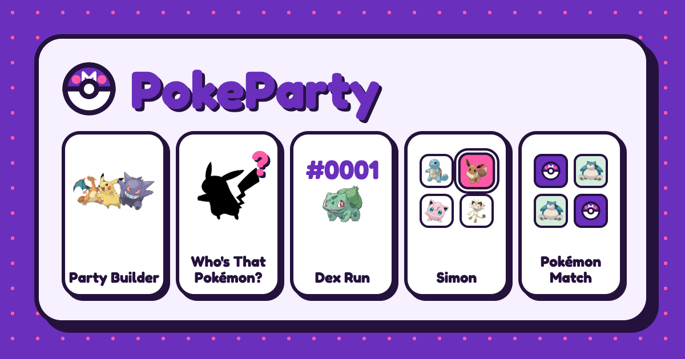

# PokeParty

Pokémon games and tools, made for phones first. Every game has a result page you can share. Your saved teams and your best scores (on the Scores page) stay in your browser.

**Play it:** https://pokeparty-sd5l.onrender.com



## Tools

- **Party Builder:** pick up to six Pokémon and share the team as a link.
- **Nature Dex (Heart & Soul):** the best natures, move lists and catch locations for the 386 Gen 1–3 Pokémon in [Pokémon Heart & Soul](https://heartsoulgame.com/) v2.0.6, a GBA ROM hack. Filter by region, role or nature, and share a filtered list by its URL. More on where the data comes from below.
- **Playthrough Timeline:** pick the game you're playing and log your team as it changes: who joined, who left, and at what level. Level-ups and evolutions (Elekid → Electabuzz) are steps too. A swap is one step. The picker shows only the Pokémon in your game's Pokédex, in that Pokédex's order. Saved in your browser.

## Games

- **Who's That Pokémon?:** a quiz with four modes: name the Pokémon from its sprite or its silhouette, pick its region, or match a Pokédex number to its sprite. Play a 30, 60 or 90 second round, or time attack.
- **Dex Run:** name Pokémon in Pokédex order, for the National Dex or a single generation.
- **Simon:** watch a sequence of Pokémon, listen to their cries, then tap it back. Easy, medium and hard boards.
- **Pokémon Match:** a memory card game with Easy, Medium and Hard boards. The Silhouette and Evolution levels pair each Pokémon with its silhouette or its evolution.
- **Name Drop:** Pokémon fall from the top of the screen. Type each name before it lands. On touch screens the game has its own letter pad, so the phone keyboard doesn't cover the screen.

## Running it locally

You need Node 24.

```sh
npm install
npm run dev
```

The app runs at http://localhost:5173.

| Command                       | What it does                                                                 |
| ----------------------------- | ---------------------------------------------------------------------------- |
| `npm run dev`                 | Start the dev server                                                         |
| `npm run build`               | Typecheck and build to `dist/`                                               |
| `npm test`                    | Run the tests with Vitest                                                    |
| `npm run lint`                | Lint with ESLint                                                             |
| `npm run typecheck`           | Typecheck with `tsc`                                                         |
| `npm run format`              | Format with Prettier                                                         |
| `npm run format:check`        | Check formatting with Prettier                                               |
| `npm run generate:pokedex`    | Rebuild `src/data/pokedex.json` from PokeAPI                                 |
| `npm run generate:nature-dex` | Rebuild `src/data/hns.json` from the H&S docs (needs Python 3)               |
| `npm run generate:game-dex`   | Rebuild `src/data/game-dex.json`, each game's Pokédex in order, from PokeAPI |

CI runs format, lint, typecheck, tests and the build on every pull request.

## Built with

React 19, TypeScript, Vite, Tailwind CSS v4 and TanStack Router. Pokémon data, artwork and cries come from [PokeAPI](https://pokeapi.co). The type icons in `public/types/` are from [pokemon-type-icons](https://github.com/partywhale/pokemon-type-icons) by James Watkins (MIT). It's hosted on Render.

What's planned next is in [TODO.md](TODO.md).

## Nature Dex data

Run `npm run generate:nature-dex` after a new H&S release. It downloads the sources into `scripts/nature-dex/raw/` (not committed) and rewrites `src/data/hns.json`.

- **Stats, types, abilities, learnsets, evolutions and locations:** the official documentation site built from [pokehns-expansion-documentation](https://github.com/PokemonHnS-Development/pokehns-expansion-documentation) (`pokedex.html`, `moves.html`).
- **TM numbers:** `include/constants/tms_hms.h` in [pokehns-expansion](https://github.com/PokemonHnS-Development/pokehns-expansion), hard-coded in `extract_hns.py`.
- **Move categories with the split off:** `src/data/types_info.h` in pokehns-expansion, hard-coded in `src/lib/nature-dex.ts`.
- **National Dex numbers:** Pokémon Showdown's `pokedex.json`.
- **Sprites:** PokeAPI's Emerald sprites, loaded at runtime. H&S uses the GBA sprites and palettes, and these match it pixel for pixel, shiny included, for all 386 except Spinda, whose spots are random per Pokémon.

### How natures are picked

There's no official list. `recommend()` in `src/lib/nature-dex.ts`:

1. Takes each final evolution's base stats, since a nature stays when a Pokémon evolves.
2. Scales Attack and Sp. Atk by the strongest move it can learn in that category, which depends on the split setting.
3. Calls it a physical, special or mixed attacker, or a wall.
4. Picks 3–5 natures for that role.

A few Pokémon (Ditto, Smeargle, Shedinja, Skarmory, Wobbuffet, Blissey) are set by hand.

Pokémon and Pokémon character names are trademarks of Nintendo, Creatures Inc. and GAME FREAK inc. This is a fan project and isn't affiliated with them.
