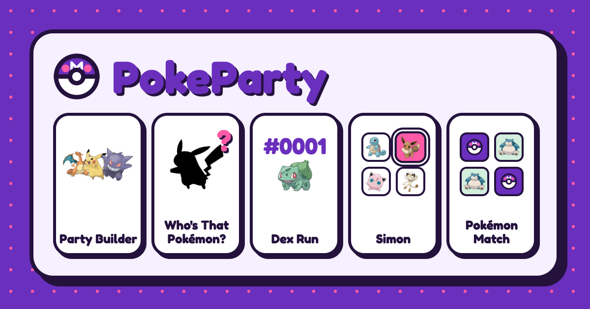

# PokeParty

Pokémon games and a party builder, made for phones first. Every game has a result page you can share. Your saved teams and your best scores (on the Scores page) stay in your browser.

**Play it:** https://pokeparty-sd5l.onrender.com



## Party Builder

Pick up to six Pokémon and share the team as a link.

## Games

- **Who's That Pokémon?:** a quiz with four modes: name the Pokémon from its sprite or its silhouette, pick its region, or match a Pokédex number to its sprite. Play a 30, 60 or 90 second round, or time attack.
- **Dex Run:** name Pokémon in Pokédex order, for the National Dex or a single generation.
- **Simon:** watch a sequence of Pokémon, listen to their cries, then tap it back. Easy, medium and hard boards.
- **Pokémon Match:** a memory card game with Easy, Medium and Hard boards. The Silhouette and Evolution levels pair each Pokémon with its silhouette or its evolution.
- **Name Drop:** Pokémon fall from the top of the screen. Type each name before it lands. On touch screens the game has its own letter pad, so the phone keyboard doesn't cover the screen.

## Running it locally

You need Node 24.

```sh
npm install
npm run dev
```

The app runs at http://localhost:5173.

| Command                    | What it does                                 |
| -------------------------- | -------------------------------------------- |
| `npm run dev`              | Start the dev server                         |
| `npm run build`            | Typecheck and build to `dist/`               |
| `npm test`                 | Run the tests with Vitest                    |
| `npm run lint`             | Lint with ESLint                             |
| `npm run typecheck`        | Typecheck with `tsc`                         |
| `npm run format`           | Format with Prettier                         |
| `npm run format:check`     | Check formatting with Prettier               |
| `npm run generate:pokedex` | Rebuild `src/data/pokedex.json` from PokeAPI |

CI runs format, lint, typecheck, tests and the build on every pull request.

## Built with

React 19, TypeScript, Vite, Tailwind CSS v4 and TanStack Router. Pokémon data, artwork and cries come from [PokeAPI](https://pokeapi.co). It's hosted on Render.

What's planned next is in [TODO.md](TODO.md).

Pokémon and Pokémon character names are trademarks of Nintendo, Creatures Inc. and GAME FREAK inc. This is a fan project and isn't affiliated with them.
